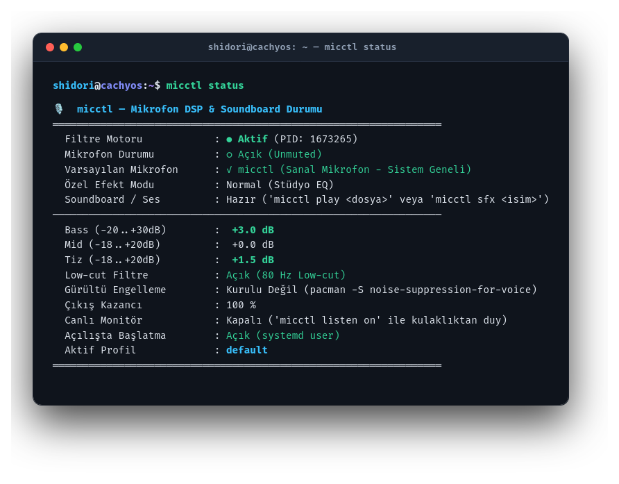
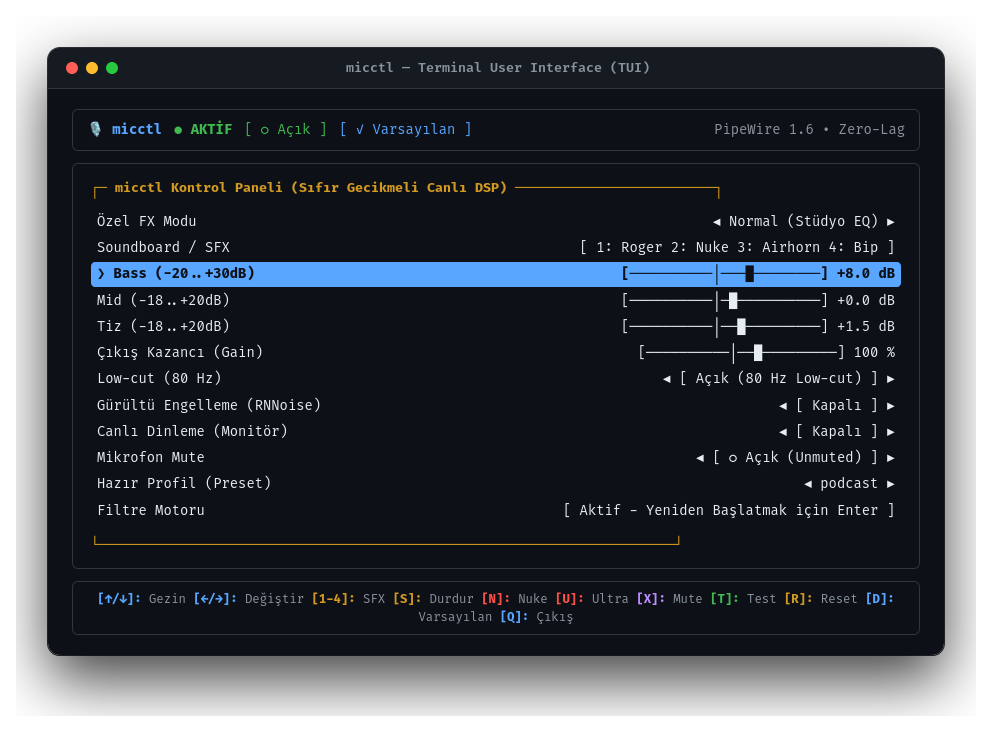

# micctl — PipeWire Mikrofon DSP, Soundboard & FX Yöneticisi (Rust)

Arch Linux (CachyOS) üzerinde PipeWire 1.6 altyapısı kullanarak doğrudan ses sürücüsüyle konuşan, **sıfır gecikmeli (zero-lag kernel param update)**, yerel ve bağımsız mikrofon filtreleme, canlı EQ, ses efektleri (Nuke, Robot, Helyum, Demon) ve dahili soundboard sağlayan yüksek performanslı CLI & TUI aracı.

<p align="center">
  
</p>

<p align="center">
  
</p>

---

## ⚡ Öne Çıkan Özellikler

- **⚡ Sıfır Gecikmeli Canlı EQ (Zero-Lag Kernel Updates):** Bass, Mid ve Tiz kaydırıcıları değiştirilirken PipeWire servisi **asla yeniden başlatılmaz**; parametreler `pw-cli s <capture_id> Props` ile anlık (~5ms) PipeWire SPA çekirdeğine enjekte edilir. TUI içinde tuşlara ne kadar hızlı basılırsa basılsın tek bir ses karesi bile atlamaz.
- **💥💥 Ultra Nuke / Kıyamet Modu (`micctl ultra`):** 5 aşamalı +50 dB bas doygunluğu, aşırı mid rezonansı ve %200 ses kazancı ile kulak zarı titreten ekstrem nuke modu.
- **💥 Standart Nuke Modu (`micctl nuke`):** 80Hz Low-shelf (+15dB) + 150Hz (+15dB) + Mid (+12dB) + %150 Gain overdrive modu.
- **🤖 Robot Modu (`micctl fx robot`):** 180Hz HPF + dar rezonanslı (Q=7-8) bant filtreler ve 3600Hz LPF ile Cybernetic Dalek sesi.
- **🐰 Tavşan / Helyum Modu (`micctl fx rabbit`):** 550 Hz HPF + bas kesimi (-18dB) + 2600Hz ve 4800Hz tepe rezonansı ile çizgi film sincap / helyum gazı ince ses efekti.
- **👹 Canavar / Demon Modu (`micctl fx demon`):** 75 Hz sub-bass (+18dB) + 190 Hz growl + 1100 Hz LPF ile karanlık, derin canavar hırıltısı.
- **📻 Telsiz / Megafon (`micctl fx walkie`):** 500Hz - 3200Hz bant geçiren filtre ve rezonans ile polis/askeri telsiz efekti.
- **☎️ Eski Telefon (`micctl fx phone`):** Sabit hat filtreleme efekti (300Hz - 3400Hz).
- **🔊 Çift Yönlü Mikrofona Ses Çalma (Soundboard):** `micctl play <dosya>` ile herhangi bir MP3, WAV veya OGG dosyasını hem mikrofondan karşıya/Discord'a aktarır hem de kullanıcının kendi kulaklığından eş zamanlı dinletir (`pw-link` dual routing).
- **📯 Gömülü Hazır SFX Efektleri:** Telsiz kapanış sesi (`roger`), nükleer siren (`nuke`), korna (`airhorn`) ve uyarı bip (`beep`) `.wav` dosyaları derleme anında doğrudan Rust binary'sinin içine (`include_bytes!`) gömülmüştür.
- **🔄 Varsayılanlara Sıfırlama (`micctl reset`):** Tüm EQ, kazanç ve efektleri tek tuşla/komutla fabrika ayarlarına döndürür.
- **🎙️ Hızlı Ses Testi (`micctl test [sn]`):** 3 saniyelik ses kaydı alıp anında kulaklığa çalarak ses tonunu test etmeyi sağlar.
- **🔔 Masaüstü Bildirimleri:** Ayar veya mod değiştiğinde Hyprland üzerinde `notify-send` ile anlık görsel bildirim.
- **🐟 Fish Shell Desteği:** Tab tuşu ile tüm komutlar, parametreler, ses dosyaları ve hazır profiller otomatik tamamlanır.
- **🚀 Açılışta Otomatik Başlama:** `micctl autostart on` ile systemd user servisini tek komutla açma/kapatma.
- **🔇 Mute & Bas-Konuş (PTT):** Tek tuşla susturma (`micctl mute toggle`) ve Hyprland için bas-konuş (`micctl ptt start/stop`).

---

## 🎛️ Genişletilmiş Parametre Aralıkları

| Parametre | Aralık | Varsayılan | Açıklama |
| :--- | :--- | :--- | :--- |
| **Bass** | `-20.0 dB` .. `+30.0 dB` | `+3.0 dB` | 120 Hz Low-shelf |
| **Mid** | `-18.0 dB` .. `+20.0 dB` | `0.0 dB` | 1800 Hz Peaking (Q=1.0) |
| **Tiz (Treble)**| `-18.0 dB` .. `+20.0 dB` | `+1.5 dB` | 6000 Hz High-shelf |
| **Gain** | `%0` .. `%200` | `%100` | Çıkış ses seviyesi |
| **Low-cut** | `Açık / Kapalı` | `Açık` | 80 Hz Masa vuruntusu kesici |

---

## 🚀 Hızlı Komut Tablosu (CLI)

```bash
# Canlı Terminal Kullanıcı Arayüzü (TUI)
micctl
micctl tui

# Durum Özeti
micctl status

# Sıfır Gecikmeli Canlı EQ (Kernel Parametre Güncellemesi: ~5ms)
micctl bass +5.0         # 5 dB artır
micctl bass set 20       # Ekstrem bas! (-20..+30 dB arası)
micctl mid +1.5          # Mid ayarı
micctl treble +2.0       # Tiz ayarı
micctl gain 125%         # Ses seviyesi (%0 .. %200)

# 💥 Ekstrem Nuke Modları
micctl ultra             # 💥💥 Ultra Nuke / Kıyamet Modu (+50dB Bas)
micctl nuke              # 💥 Standart Nuke Modu toggle

# 🎭 Özel Ses Efektleri (Voice FX)
micctl fx robot          # 🤖 Metalik Robot
micctl fx rabbit         # 🐰 Tavşan / Helyum (İnce ses)
micctl fx demon          # 👹 Canavar / Demon (Karanlık kalın ses)
micctl fx walkie         # 📻 Telsiz / Megafon
micctl fx phone          # ☎️ Eski telefon
micctl fx none           # Normal stüdyo EQ moduna dön

# 🔊 Mikrofona Ses Çalma (Soundboard & Dual-Routing)
micctl play ~/Müzik/meme.mp3
micctl play ~/Müzik/siren.wav 120
micctl stop-play

# 📯 Dahili Ses Efektleri (SFX)
micctl sfx roger         # Telsiz bas-konuş kapanış sesi
micctl sfx nuke          # Nükleer siren & patlama
micctl sfx airhorn       # Meme korna sesi
micctl sfx beep          # UI bip sesi

# 🎙️ Sesini Kaydet ve Dinle (3 saniye test)
micctl test 3

# 🔇 Mute, Bas-Konuş (PTT) & Hold-to-Nuke
micctl mute toggle       # Sustur / aç
micctl ptt start         # Mikrofonu aç
micctl ptt stop          # Mikrofonu sustur
micctl hold-nuke start   # Basılı tutulduğunda nuke patlatır
micctl hold-nuke stop    # Bırakıldığında normale döner

# ⚙️ Sistem & Profil Yönetimi
micctl default           # Sanal mikrofonu sistem varsayılanı yap
micctl autostart on      # Açılışta başlama (systemd user service)
micctl preset list       # Hazır EQ profillerini listele
micctl preset load podcast # Profil yükle (podcast, gaming, deep-bass vb.)
micctl waybar            # Hyprland Waybar için JSON çıktısı
micctl reset             # Fabrika ayarlarına sıfırla
```

---

## ⌨️ TUI Kısayol Tuşları (`micctl`)

| Tuş | İşlev |
| :--- | :--- |
| `[↑/↓]` / `[k/j]` | Menüde yukarı/aşağı gezinme |
| `[←/→]` | Değeri anlık değiştirme (Sıfır gecikmeli PipeWire kernel güncellemesi) |
| `[1-4]` | Hızlı SFX çal (1: Roger, 2: Nuke, 3: Airhorn, 4: Bip) |
| `[S]` | ⏹️ Çalan sesi durdur |
| `[N]` | 💥 Nuke modunu aç/kapat |
| `[U]` | 💥💥 Ultra Nuke (Kıyamet) modunu aç/kapat |
| `[X]` | 🔇 Mikrofonu sustur / aç (Mute toggle) |
| `[L]` | 🎧 Canlı dinleme (Monitör) aç/kapat |
| `[T]` | 🎙️ 2 saniyelik hızlı ses testi yap ve dinle |
| `[R]` | 🔄 Fabrika ayarlarına sıfırla (Reset) |
| `[D]` | 🎙️ Sanal mikrofonu sistem varsayılanı yap |
| `[Q]` / `[Esc]` | Çıkış |

---

## 🏗️ Mimari & Dosya Yapısı

- **İkili (Binary):** `~/.local/bin/micctl` $\rightarrow$ `~/projects/micctl/micctl`
- **Ayarlar ve Durum:** `~/.config/micctl/config.json`
- **Filter-chain Yapılandırması:** `~/.config/micctl/filter-chain.conf`
- **Hazır Profiller:** `~/.config/micctl/presets/*.json`
- **Dahili Sesler:** `~/.config/micctl/sounds/*.wav`
- **Systemd Servisi:** `~/.config/systemd/user/micctl.service`
- **Fish Shell Tamamlama:** `~/.config/fish/completions/micctl.fish`

---

## 🛠️ Derleme & Kurulum

```bash
# Bağımlılıklar (Arch / CachyOS)
sudo pacman -S pipewire libpipewire mpv

cd ~/projects/micctl
cargo build --release

# Binary'yi bağla
ln -sf $(pwd)/target/release/micctl ~/.local/bin/micctl
```
